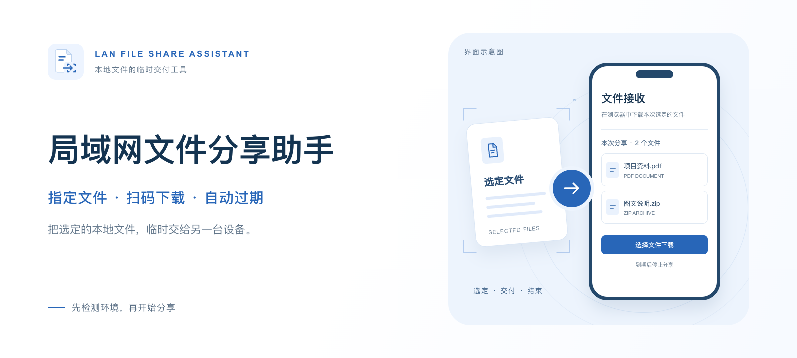
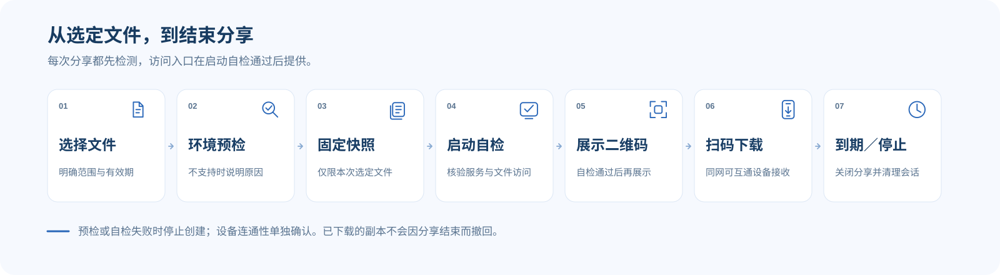
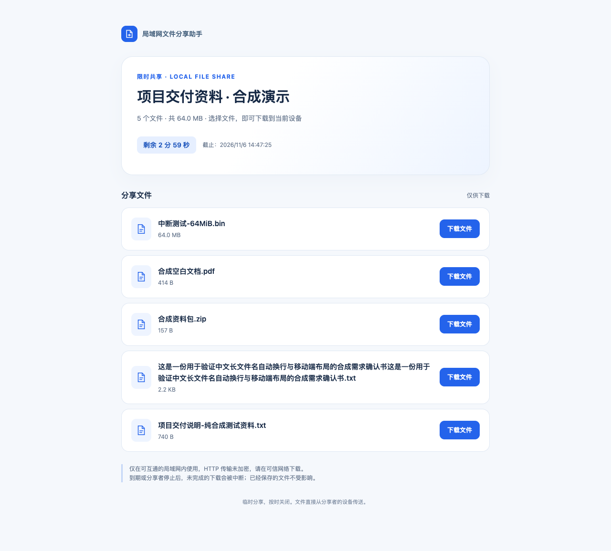

<p align="center">
  
</p>

<h1 align="center">局域网文件分享助手</h1>
<p align="center"><strong>让 Agent 生成的文件，顺畅抵达另一台设备。</strong></p>
<p align="center">LAN File Share Assistant<br>面向本地 Agent 的临时文件交付 Skill</p>

<p align="center">
  <a href="LICENSE"></a>
  <a href="releases/0.1.0/manifest.json"></a>
  
  <a href="https://github.com/zcjunblog/lan-file-share-assistant/actions/workflows/native-platforms.yml"></a>
</p>
<p align="center">
  <a href="#核心能力">核心能力</a> ·
  <a href="#快速开始">快速开始</a> ·
  <a href="#工作流程">工作流程</a> ·
  <a href="#下载体验">下载体验</a> ·
  <a href="#兼容性与验证">兼容性与验证</a> ·
  <a href="#参与贡献">参与贡献</a>
</p>

需求确认书写好了，操作手册生成了，图片和资料包也已准备完成。下一步，可以直接对 Agent 说：

> **把刚生成的文件分享给我的手机，十分钟后关闭。**

局域网文件分享助手先检测文件所在电脑的运行条件，再为明确选定的文件创建私有快照、限时下载页和本地二维码。接收方通过浏览器保存文件，无需安装专用接收应用；到期或提前停止后，由后台程序关闭连接并清理临时资料。

适合办公交接、项目交付、培训资料分发，以及 Agent 产物的跨设备取用。支持标准 Agent Skills 目录，并提供独立的 WorkBuddy 导入包。

## 核心能力

**0.2.0 候选版**支持新建共享文件夹。放入、替换或移出文件，同一个扫码页会自动更新。会话到期或提前结束后，文件留在电脑上。Windows 可在一次性准备运行环境后双击启动。使用方法见[运行与故障处理](skills/lan-file-share-assistant/references/runtime.md#共享文件夹)。

**0.2.1 候选版**优化在 AI 对话里直接发起的分享。指定文件后，程序一次执行环境检查、探针和启动，下一次工具调用确认服务可用后即交付二维码。可下载[通用候选包](releases/0.2.1/lan-file-share-assistant-0.2.1.zip)和 [WorkBuddy 候选包](releases/0.2.1/lan-file-share-assistant-workbuddy-0.2.1.zip)。

| 能力 | 交付方式 |
| --- | --- |
| **先检测，再分享** | 检查执行位置、运行时、文件、专用目录、二维码、网卡、端口及进程生命周期；缺少条件时给出原因与复检步骤 |
| **文件范围明确** | 仅处理用户逐项授权的普通文件，原文件只读，以本次私有快照提供下载 |
| **扫码即可取件** | 本机生成PNG/SVG二维码，接收方通过同一可互通局域网的浏览器下载 |
| **分享自动过期** | 默认10分钟，可选1至60分钟；截止由后台程序执行，刷新页面不会续期 |
| **可以提前结束** | 校验本次会话归属后停止分享，中断进行中的传输，撤销凭据并清理临时副本 |

每次支持1至20个指定文件，单个不超过2GiB、合计不超过5GiB。macOS已完成5GiB合成本机HTTP验证，真实跨设备吞吐和其他系统的大文件行为仍待验收。

## 快速开始

### 1. 获取 Skill

| 使用方式 | 入口 |
| --- | --- |
| 通用 Agent 客户端 | [下载标准 Skill 包](https://raw.githubusercontent.com/zcjunblog/lan-file-share-assistant/main/releases/0.1.0/lan-file-share-assistant-0.1.0.zip) |
| WorkBuddy 自定义技能导入 | [下载 WorkBuddy 包](https://raw.githubusercontent.com/zcjunblog/lan-file-share-assistant/main/releases/0.1.0/lan-file-share-assistant-workbuddy-0.1.0.zip) |
| 直接使用源码 | [skills/lan-file-share-assistant](skills/lan-file-share-assistant/SKILL.md) |
| 核验归档 | [SHA256SUMS](releases/0.1.0/SHA256SUMS) · [逐文件清单](releases/0.1.0/manifest.json) |

解压后保留整个`lan-file-share-assistant`目录，按客户端规则导入。标准包和WorkBuddy包使用相同业务文件，后者仅扩展展示元数据和三组双语示例。

### 2. 准备本机运行环境

需要能够在**文件所在电脑**执行Python并维持后台进程的本地Agent。使用源码时，macOS/Linux可在项目目录准备独立环境：

```sh
git clone https://github.com/zcjunblog/lan-file-share-assistant.git
cd lan-file-share-assistant
python3 -m venv .venv
.venv/bin/python -m pip install -r skills/lan-file-share-assistant/requirements.txt
```

运行要求为Python3.9+，二维码直接依赖Segno1.6.6。文件传输和二维码生成不依赖模型API、外部二维码服务或公网中转；准备依赖时可能需要联网。

常见项目级安装位置：Codex使用`.agents/skills/`，Claude Code使用`.claude/skills/`，Cursor使用`.cursor/skills/`；其他客户端使用其明确支持的Skills目录或导入功能。完整目录规则、Windows命令和系统要求见[安装与兼容性](docs/compatibility.md)。目录接入与实际运行能力分别验证。

### 3. 在对话中选择文件

> 使用局域网文件分享助手，把刚生成的需求确认书分享给我的手机，先检测本地配置，十分钟后关闭。

> 将我指定的三份操作手册生成扫码下载页，五分钟后自动过期。

> 停止刚才的文件分享，确认下载入口已关闭、临时副本已清理。

Agent会核对实际产物与授权范围，执行预检并在独立工具调用中确认服务状态。只有`ready`且`can_publish=true`，才会展示真实链接、二维码、文件清单和截止时间。客户端无法确认本机执行位置或维持后台进程时，会说明原因并停止创建。

## 工作流程



| 阶段 | 处理内容 | 可以查看的结果 |
| --- | --- | --- |
| **01 · 确定范围** | 核对指定文件、分享标题与有效期 | 本次文件清单与运行位置 |
| **02 · 本机预检** | 执行八项检查，确认跨调用进程存活 | 逐项结论、失败原因与复检方法 |
| **03 · 准备快照** | 复制私有副本，核对来源身份和内容摘要 | 固定的文件版本与准备状态 |
| **04 · 启动自检** | 绑定选定接口，独立核验健康和文件访问 | 可发布的真实就绪状态 |
| **05 · 交付入口** | 展示本地二维码、链接、截止时间与停止方式 | 本次接收者使用的限时入口 |
| **06 · 接收下载** | 在另一台同网设备浏览并保存文件 | 接收方实际下载结果 |
| **07 · 结束分享** | 到期自动关闭，或用户提前停止 | 监听、凭据与临时副本清理状态 |

本机自检与另一设备下载分别记录。分享入口包含访问凭据，应只交给本次接收者；页面刷新、再次扫码和下载失败不会自动延长有效期。重新分享需要新建会话。

## 下载体验

白蓝页面优先适配移动端，展示文件名称、大小、剩余时间与下载入口。中文长文件名自动换行，页面与服务端分别执行截止控制。



[手机宽度](evidence/m2/download-mobile.png) · [页面失效状态](evidence/m2/download-expired-mobile.png)

封面为标注过的界面示意图，下载页面截图来自合成资料的实际浏览器验证。服务关闭后，浏览器可能直接显示无法连接。已保存到接收端的副本不会被撤回。

## 兼容性与验证

| 环境 | 当前范围 |
| --- | --- |
| **macOS** | Codex执行工具、WorkBuddy5.9.3及0.1.0最终安装包完成本机链路；已有手机内容回读和停止后旧链接失效反馈 |
| **Windows · 实验性** | Windows2022 × Python3.9/3.12原生CI通过，包含安全文件/ACL、后台探针、环回下载、停止和实际短时到期组件 |
| **Linux · 实验性** | Ubuntu24.04 × Python3.9/3.12原生CI通过，包含文件/权限、后台探针、环回下载、停止和实际短时到期组件 |
| **其他 Agent** | 标准Skill格式可以接入，后台执行与网络能力需要在具体客户端验证 |

最终WorkBuddy安装验收按四次独立调用完成probe、start、status与下载、stop；10,600字节的源文件、状态摘要和下载副本一致。归档另完成独立解压、二维码回读、提前停止与真实60秒自然到期检查。当前本地回归为73项通过、14项Windows原生测试按环境跳过。

Windows/Linux完整生产worker、传输中截止、真实LAN与Agent仍待设备验收；云端CI不替代这些结果。整机睡眠恢复、实际系统时钟变更、整个宿主退出和手机保存副本摘要也仍待补验。

**WorkBuddy0.1.0已提交审核，尚未确认上线。** GitHub源码、导入包与平台审核状态分别记录。

[系统验收](evidence/platforms/README.md) · [最终包与提审记录](evidence/release/README.md) · [归档验收](evidence/m4/README.md) · [容量补验](evidence/m3/continuation.md)

## 运行要求与边界

- 在可信、可互通的局域网使用，**HTTP未加密**。防火墙、访客网络、AP隔离和客户端权限会影响接收方访问。
- 只绑定经过核对的物理IPv4私有接口；不自动关闭防火墙、修改VPN/路由、绑定所有网卡或开启公网穿透。
- 使用新的专用运行目录和足够磁盘空间。Windows要求本机固定卷与原生私有ACL，拒绝UNC、网络卷、备用数据流及重解析点。
- 首版提供下载，不提供上传、目录共享、长期托管、设备自动发现、HTTPS或已下载副本撤回。

遇到问题时，按`reason_code`和`remediation`区分运行环境、文件、权限、接口、绑定及生命周期故障，再单独检查接收方网络。命令与处理方式见[运行参考](skills/lan-file-share-assistant/references/runtime.md)。

## 开发与构建

运行依赖与开发验证分开，开发示例使用Python3.12：

```sh
python3.12 -m venv .venv
.venv/bin/python -m pip install -r requirements-m2-dev.txt
.venv/bin/python -m unittest discover -s tests -v
.venv/bin/python tools/check_m2_repository.py
.venv/bin/python tools/build_release.py
```

两个包共用`skills/lan-file-share-assistant/VERSION`和显式资源登记。构建输出包含归档与逐文件SHA-256；已提交市场的包按记录保留摘要。开发测试与分享产生的文件、地址、二维码、凭据和原始状态只写入忽略目录。

完整生产链路验收会短时启动局域网服务，按[归档验收说明](evidence/m4/README.md)显式执行。CI仅使用合成文件，日志输出脱敏检查摘要，结束后清理其拥有的资源。

## 参与贡献

欢迎提交Issue、改进文档或参与PR，尤其欢迎补充Windows/Linux真实设备与不同Agent客户端的验收结果。反馈时记录系统、Python、客户端版本、复现步骤和实际结果，使用合成资料并移除私有运行信息。

[贡献指南](CONTRIBUTING.md) · [提交问题](https://github.com/zcjunblog/lan-file-share-assistant/issues) · [产品设计](memory-bank/design.md) · [开发待办](memory-bank/todo.md)

## 开源许可

本项目采用[MIT许可证](LICENSE)。使用、修改或再分发时请保留版权与许可声明；第三方依赖遵循其各自许可证。图标与封面的来源和制作方式见[视觉记录](docs/marketplace/icon-generation.md)。

维护者：[zcjunblog](https://github.com/zcjunblog)。
