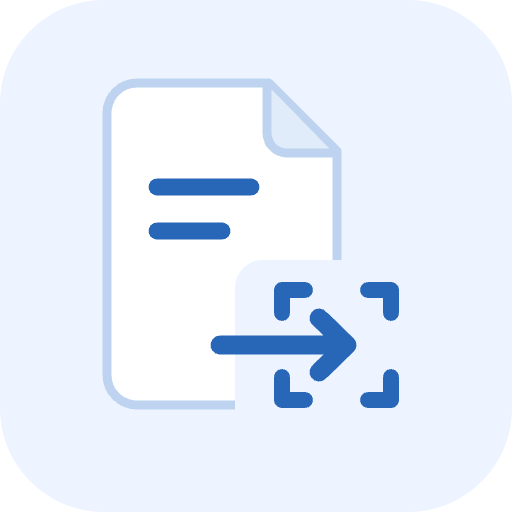

<p align="center"></p>
<h1 align="center">局域网文件分享助手</h1>
<p align="center"><strong>选定文件，扫码下载，按时关闭。</strong><br>LAN File Share Assistant · 面向本地 Agent 的临时文件交付 Skill</p>


从需求确认书、图文操作手册到图片与资料包，让 Agent 生成的文件抵达另一台设备。助手先检测文件所在电脑的运行条件，再准备私有副本和限时下载页面；接收方通过浏览器扫码取件，分享结束后关闭连接并清理临时资料。

**0.1.0 发布候选** · [标准 Skill 包](releases/0.1.0/lan-file-share-assistant-0.1.0.zip) · [WorkBuddy 包](releases/0.1.0/lan-file-share-assistant-workbuddy-0.1.0.zip) · [安装与兼容性](docs/compatibility.md) · [校验摘要](releases/0.1.0/SHA256SUMS)

当前已完成原生系统CI；macOS的Codex与WorkBuddy开发包已有实际链路验证。**Windows/Linux为实验性支持**，真实局域网与客户端仍待补验。仓库目前保持私有，本版本尚未上传平台解析、提交审核或公开发布。

## 为文件交付准备

| 能力 | 实际行为 |
| --- | --- |
| 分享前检测 | 核对执行位置、运行时、文件、任务目录、二维码、网卡、绑定和生命周期；缺少条件时给出原因与复检步骤 |
| 范围明确 | 仅处理逐项授权的普通文件，以私有快照提供下载；原文件保持只读 |
| 扫码取件 | 本机生成PNG/SVG二维码和移动端下载页，接收方无需安装专用应用 |
| 限时访问 | 默认10分钟，支持1至60分钟；后台程序执行截止时间，刷新页面不会续期 |
| 随时结束 | 提前停止本次会话，中断进行中的传输，撤销凭据并清理临时副本 |

每次可选1至20个文件，单个不超过2GiB、合计不超过5GiB。macOS已完成5GiB合成本机HTTP容量验证；真实跨设备吞吐和其他系统大文件行为仍待验收。

## 从选择到交付


1. **确定范围**：选择本次分享的文件、标题与有效期，确认程序运行在文件所在电脑。
2. **检查配置**：八项预检全部通过才允许继续；条件不满足时说明具体失败项。
3. **准备副本**：复制到本次私有会话目录，核对文件身份与内容摘要。
4. **启动自检**：启动服务，并在下一次独立工具调用中核验状态和本机健康。
5. **交付入口**：展示已验证的二维码、链接、文件清单、截止时间与停止方式。
6. **接收下载**：手机或另一台电脑连接可互通局域网，通过浏览器保存文件。
7. **结束分享**：到期自动关闭，或由用户提前停止；核实监听及临时资料的实际状态。

本机自检通过与接收方下载成功分别记录。二维码和链接包含访问凭据，应仅交给本次接收者；本项目不会将它们上传到外部二维码服务。

## 对 Agent 这样说

> 把刚生成的需求确认书分享给我的手机，先检测本地配置，十分钟后关闭。

> 将我指定的这三份操作手册生成局域网扫码下载页，五分钟后自动过期。

> 停止刚才的文件分享，确认下载入口已关闭、临时副本已清理。

“刚生成的文件”应由当前任务的实际产物清单确定。助手不会据此扫描桌面、共享整个目录或自动扩大文件范围。

## 下载体验

白蓝页面优先适配移动端，提供文件名称、大小、剩余时间与下载入口。中文长文件名自动换行，页面与后端分别执行失效处理。


[手机宽度](evidence/m2/download-mobile.png) · [页面失效状态](evidence/m2/download-expired-mobile.png)

封面为产品示意图；上方下载页面来自合成资料的实际浏览器验证。服务关闭后浏览器可能直接显示无法连接，已保存到接收端的副本不会被撤回。

## 安装与运行

需要**能够在文件所在电脑执行程序并维持后台服务的本地 Agent**，以及Python3.9+。二维码直接依赖Segno1.6.6，不需要模型API或云端二维码服务；准备Python依赖时可能需要联网。

| 分发形式 | 接入方式 |
| --- | --- |
| 标准Skill | 解压标准包，将整个`lan-file-share-assistant`目录放入客户端支持的Skills目录，保留入口和所有子资源 |
| WorkBuddy | 使用WorkBuddy包导入；该包添加展示信息和三组双语示例，业务脚本与标准包一致 |
| 仓库源码 | 标准入口位于[skills/lan-file-share-assistant](skills/lan-file-share-assistant/SKILL.md)，可直接按客户端规则接入 |

依赖应安装到选定的任务虚拟环境，不修改全局Python。具体命令、常见客户端路径与系统要求见[安装与兼容性](docs/compatibility.md)，命令流程与故障处理见[运行参考](skills/lan-file-share-assistant/references/runtime.md)。安装目录适配不代表所有客户端都能提供后台网络服务。

## 验证范围

| 范围 | 当前证据 |
| --- | --- |
| macOS | Codex执行工具与WorkBuddy V5.9.3开发包已完成本机链路；用户手机内容回读和停止后旧链接失效已有反馈 |
| Windows，实验性 | Windows 2022的Python3.9/3.12原生CI通过；安全文件/ACL、跨调用探针、环回下载、停止与实际短时到期组件已验证 |
| Linux，实验性 | Ubuntu 24.04的Python3.9/3.12原生CI通过；安全文件/权限、跨调用探针、环回下载、停止与实际短时到期组件已验证 |
| 发布候选归档 | 标准包与WorkBuddy包分别解压运行，原始文件、快照及下载摘要独立核对；结果见M4验收记录 |

Windows/Linux完整生产worker、传输中截止、真实局域网扫码和具体Agent尚待设备验收。用户暂缓整机睡眠；真实系统时钟变更、整个宿主退出和手机保存副本的独立摘要也仍待补。最终包的WorkBuddy平台解析及安装后Agent烟测保留为后续检查。

[跨平台CI证据](evidence/platforms/README.md) · [既有客户端与手机记录](evidence/m3/README.md) · [容量和运行时补验](evidence/m3/continuation.md) · [M4归档验收](evidence/m4/README.md)

## 使用边界

用于可信、可互通的局域网，**HTTP未加密**。防火墙、访客网络、AP隔离和客户端权限会影响其他设备的访问；助手不会自动关闭防火墙、修改路由/VPN或开启公网穿透。

首版提供下载，不提供上传、目录共享、长期托管、设备自动发现、HTTPS或已下载副本撤回。只看到云端、容器或未知执行位置时，生产预检会阻止创建分享。

## 开发与维护

运行依赖与开发验证分开。开发示例使用Python3.12：

```sh
python3.12 -m venv .venv
.venv/bin/python -m pip install -r requirements-m2-dev.txt
.venv/bin/python -m unittest discover -s tests -v
.venv/bin/python tools/build_release.py
```

两个归档共享单一版本源`skills/lan-file-share-assistant/VERSION`，只在WorkBuddy入口元数据上存在差异。构建输出含逐文件摘要、归档SHA-256和完整清单。合成服务验收须按[M4记录](evidence/m4/README.md)显式执行，本机地址、二维码、凭据和原始状态均保存在忽略目录。

[产品设计](memory-bank/design.md) · [开发待办](memory-bank/todo.md) · [预检协议](docs/preflight-and-session-protocol.md) · [协作约定](Agent.md)

公开范围、许可证、收费方式和市场提交另行决定。维护者：[zcjunblog](https://github.com/zcjunblog)。
